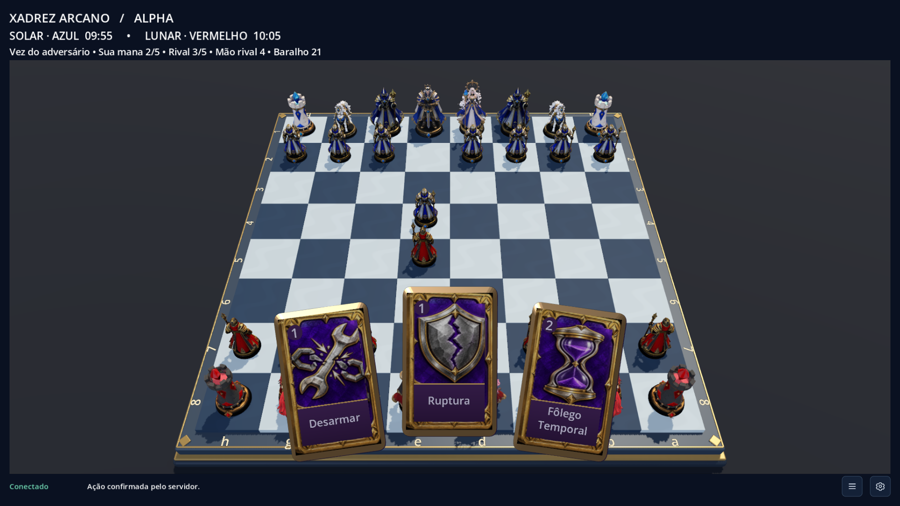

# Xadrez Arcano

Jogo Windows de xadrez 3D com cartas mágicas e servidor autoritativo. Alpha para convidados; Steam, ranking, loja e IA adversária ficam para depois.



## Desenvolvimento

Godot/GDScript, Python 3.13/FastAPI, motor de xadrez próprio e PostgreSQL. Consulte [o plano](docs/PLANO.md) e [o documento de visão](Xadrez_Arcano_Projeto_Completo.md).

Ferramentas serão portáteis quando possível. Nenhum aplicativo, container ou serviço do projeto deve iniciar com o Windows. Docker Desktop permanece manual; PostgreSQL roda exclusivamente em container.

## Preparação e execução

**Neste computador, as ferramentas já estão instaladas. Abra `Jogar.cmd` com dois cliques**, na pasta do projeto. Ele inicia o servidor e abre duas janelas já autenticadas, uma para cada lado. Não é necessário preencher convite ou sala. Para encerrar o servidor depois de fechar as janelas, abra `Parar.cmd`.

Os arquivos `.cmd` usam uma política de execução apenas para o processo que abre o jogo. Não alteram a configuração permanente do PowerShell nem adicionam programas à inicialização do Windows.

Para preparar uma cópia nova, no PowerShell dentro desta pasta:

```powershell
powershell -NoProfile -ExecutionPolicy Bypass -File .\tools\Install-Tools.ps1
powershell -NoProfile -ExecutionPolicy Bypass -File .\tools\Setup-Dev.ps1
.\Jogar.cmd
```

Na primeira vez o Docker pode demorar a abrir. Requer Docker Desktop com WSL2/virtualização já configurados e Python 3.13. As instalações não criam entradas de inicialização do Windows. Não é preciso abrir o Blender para jogar.

Para encerrar, feche as janelas e execute `./tools/Stop-Dev.ps1`. Isso preserva o banco. O Docker Desktop pode ser fechado normalmente depois; o script não encerra outros projetos.

Para apenas iniciar o backend: `./tools/Start-Dev.ps1`. Para abrir um cliente: `./tools/Open-Client.ps1 -Profile A`. Gere um convite com `./tools/New-Invite.ps1`; no jogo, entre com esse convite, crie uma sala e compartilhe o código com outro convidado. Convites de acesso e códigos de sala são coisas diferentes.

## Jogar

- As peças azuis são do lado Solar (brancas) e jogam primeiro; as vermelhas são do lado Lunar (pretas). São dois jogadores: cada janela controla um lado.
- A apresentação usa base Full HD (1920×1080) e abre maximizada. **F11** alterna a tela cheia; **Esc** sai dela. O tabuleiro e as peças ocupam uma área maior da tela.
- Clique em uma peça sua e depois numa casa destacada.
- Clique numa carta, escolha o alvo no tabuleiro e confirme **Conjurar**. Cartas pessoais usam alvo automático. Dissipação exige escolher qual efeito remover.
- As cartas usam um modelo físico 3D compartilhado, com imagens intercambiáveis, e flutuam sobre o jogo em um leque de aproximadamente 320 px de altura em Full HD. Nome e mana ficam dentro da face. Ao levar o mouse da mão ao tabuleiro, ela recolhe para liberar peças e alvos; passe nas bordas inferiores para abrir novamente. Cancelar ou conjurar também reabre a mão. O botão **Conjurar** fica na barra lateral acessível por **☰**. A preferência de animações controla as transições.
- Faça o movimento depois da carta. Existe uma única conjuração por turno.
- Botão direito arrastado gira a câmera; roda do mouse aproxima; há opção de visão superior.
- O botão **☰**, ao lado da engrenagem no rodapé, mostra ou oculta toda a barra lateral (conexão, salas, tutorial, ações, histórico e catálogo). Ela começa oculta; sua escolha é salva por perfil. Ao recolher, o tabuleiro e as cartas ocupam o espaço liberado.
- A qualidade alta usa o renderizador Forward+, suavização 4×, sombras e oclusão ambiente. Na **engrenagem do canto inferior direito**, as opções Médio e Baixo reduzem esses efeitos. O mesmo menu reúne animações, visão superior e tela cheia.
- O tutorial ensina movimento, defesa e armadilha usando cenários do servidor.
- O relógio continua durante animações, escolhas e desconexões individuais. Falha/reinício do servidor anula partidas em andamento.

## Diagnóstico de problemas

O rodapé mostra **Conectando**, **Conectado**, **Reconectando** ou **Falha na conexão**, separado das mensagens das ações. A conexão só é confirmada depois de receber o estado da partida. Cada tentativa aguarda até 10 segundos; há três novas tentativas automáticas, com intervalos de 2, 4 e 8 segundos. Depois disso, confira o servidor e use **Reconectar partida**.

Abra a **engrenagem**, marque **Ativar logs detalhados** e reproduza o problema. **Abrir pasta de logs** mostra os arquivos dessa janela. Com o checkbox desligado, os erros essenciais continuam sendo registrados. As preferências são salvas por perfil, separadamente das credenciais.

- Cliente: `%APPDATA%\Godot\app_userdata\Xadrez Arcano\logs\<perfil>\`. JSONL por execução, com arquivos de até 2 MB, preservando os cinco arquivos fechados mais recentes e os arquivos em uso.
- Inicialização e console do Godot: `.runtime/logs/`. Em caso de falha, o iniciador informa o arquivo para consulta. Dados temporários de autenticação usam nomes exclusivos e são removidos assim que o jogo os lê.
- Servidor: logs operacionais em `docker compose --env-file .env -f ops/compose.yaml logs api`, com rotação configurada no Docker. O checkbox não altera o nível de registro do servidor.

Os registros não incluem tokens, convites, códigos de sala, senhas, mãos, armadilhas ou payloads completos. Nenhum log é enviado automaticamente. Falhas ao gravar não interrompem o jogo.

## Verificação, backup e build

```powershell
./.venv/Scripts/python.exe -m pytest server/tests -q
./.venv/Scripts/python.exe -m ruff check server tools
./.venv/Scripts/python.exe tools/smoke_clients.py --visible
./.venv/Scripts/python.exe tools/smoke_clients.py --visible --reconnect
./.venv/Scripts/python.exe tools/test_client_network.py
./Jogar.cmd -SmokeTest
./tools/Backup.ps1
./tools/Export-Windows.ps1
```

O teste de concorrência PostgreSQL usa `TEST_DATABASE_URL`, apontado para um banco isolado; CI já o configura. O executável exportado fica em `exports/windows/XadrezArcano.exe` e precisa do servidor ativo. A build não inclui servidor offline.

As regressões Godot estão em `client-godot/tests/`: seleção por eventos reais de mouse, configurações, rotação dos logs e estados de conexão. O teste de diagnóstico provoca um erro de script e uma pasta inacessível de propósito para verificar sua captura; essas mensagens são esperadas somente nesse teste.

Backups são cifrados com `BACKUP_KEY` de `.env`. Guarde essa chave separadamente: sem ela o backup não pode ser aberto. Restauração segura: `./tools/Restore-Backup.ps1 -File backups/arquivo.fernet`, sempre num banco novo `arcano_restore...`.

Nunca versionar credenciais, ambientes virtuais, binários das ferramentas ou dados do banco. Consulte [status e limitações](docs/STATUS.md), [protocolo](docs/PROTOCOL.md) e [implantação Linux](docs/DEPLOY.md).

