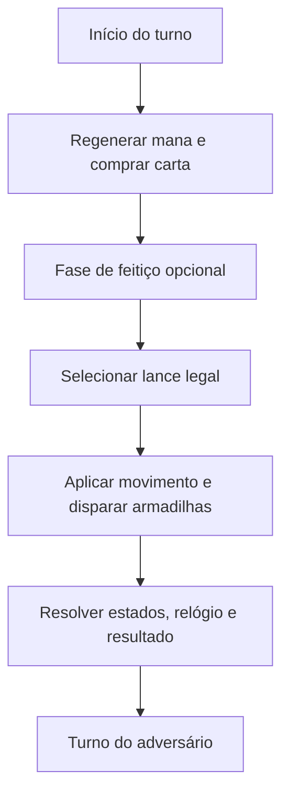
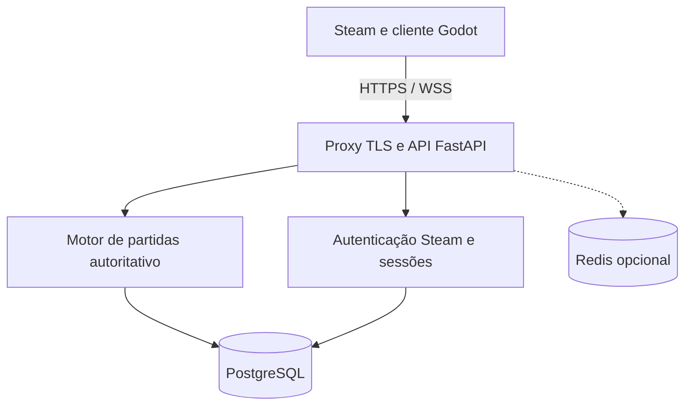

# XADREZ ARCANO — Documento de Visão, Game Design e Arquitetura Técnica

**Versão:** 1.1 — decisões de implementação consolidadas  
**Data:** 19/10/2026  
**Status:** proposta de produto e decisões técnicas iniciais; ainda não é código implementado  
**Nome de trabalho:** Xadrez Arcano (*Arcane Chess*) — verificar disponibilidade de nome/marca antes de divulgar ou registrar na Steam.

> **Revisão aprovada:** [docs/PLANO.md](docs/PLANO.md) prevalece nos conflitos com o planejamento inicial abaixo. Motor de xadrez próprio, alpha com 12 cartas e convites antes de Steam; PostgreSQL antecipado; mate/afogamento consideram carta + movimento; empates simplificados; reinício inesperado anula partidas ativas. Ferramentas e containers locais não iniciam com o Windows. Recibos de comandos ficam separados dos eventos. Roadmap e DDL abaixo são a proposta original, não o estado implementado; consultar [docs/STATUS.md](docs/STATUS.md).

---

## 0. Resumo executivo e decisões

Criar um jogo **PvP de xadrez 3D online para PC**, com peças e movimentos reconhecíveis do xadrez tradicional, mas com **cartas mágicas capazes de proteger peças, preparar armadilhas e alterar opções táticas**. A inspiração é a dramaticidade dos duelos de cartas de animes: invocações visuais, efeitos, contrajogadas e tensão. **Não usar nomes, personagens, imagens, trilhas, cartas, ícones ou identidade visual protegidos de Yu-Gi-Oh!**; construir propriedade intelectual original.

O servidor será **autoritativo**: possui o estado verdadeiro do tabuleiro, mão e baralho de cada jogador, cartas disponíveis, mana, relógios, inventário, classificação e resultados. O executável do jogador só **exibe uma projeção autorizada desse estado** e envia intenções, como `mover e2-e4` ou `conjurar escudo na torre de a1`.

> **Limite de segurança importante:** um jogo 3D instalado via Steam inevitavelmente entrega ao computador do jogador os modelos, texturas e código de apresentação. Não é possível impedir totalmente a inspeção/modificação desses arquivos ou o uso de um motor externo de xadrez. É possível impedir que um cliente adulterado *autorize* posições impossíveis, invente cartas, aumente saldos, enxergue armadilhas ocultas pela API ou altere resultados oficiais.

### Stack recomendada

| Camada | Escolha | Motivo |
|---|---|---|
| Cliente desktop | **Godot 4.x estável, GDScript** | Gratuita, leve, renderização 3D, interface e animações fáceis de prototipar; exportação Windows |
| Modelos 3D | **Blender** | Modelagem, materiais, rigging e animação sem custo de licença da ferramenta |
| Formato dos modelos | **glTF 2.0 / `.glb`** | Pipeline de importação amplamente suportado pelo Godot |
| API e partidas | **Python 3.x + FastAPI + WebSocket seguro (WSS)** | Regras por turnos, testes fáceis, autenticação e mensagens em tempo real |
| Motor de regras | **Domínio próprio** + avaliação de biblioteca de xadrez | Xadrez tradicional reaproveitável; efeitos mágicos exigem camada específica |
| Persistência | **PostgreSQL** | Transações, restrições, auditoria e recuperação de partidas |
| Cache/fila | **Redis (opcional na fase 1)** | Matchmaking e escalonamento somente quando necessários |
| Infraestrutura | **Linux VPS/instância + Docker Compose + proxy TLS** | Baixo custo operacional inicial e deploy repetível |
| Distribuição | **Steamworks / Steam Direct** | Autenticação de usuário Steam e publicação na loja |
| Versionamento | **Git** | Projeto, testes, ativos e documentação rastreáveis |

**Decisão central:** não criar um servidor gráfico transmitindo vídeo para cada jogador. O cliente renderiza localmente; o servidor executa **100% das regras e dos dados sensíveis**. Streaming de vídeo de jogos em nuvem seria muito mais caro e não resolveria todos os tipos de trapaça.

### Alternativas avaliadas

| Alternativa | Vantagem | Desvantagem | Escolha |
|---|---|---|---|
| Godot + FastAPI | Ótimo para turnos, separação clara e fácil teste de regras | Dois projetos e protocolo a manter | **Recomendada** |
| Godot cliente + Godot headless servidor | Compartilha tecnologia; Godot admite exportação de servidor dedicado | Integração com banco, autenticação e testes de domínio requer mais trabalho | Viável |
| Unity cliente + backend | Ecossistema amplo de assets | Mais dependências e decisões de licenciamento/distribuição | Alternativa |
| Unreal Engine | Alto potencial visual | Projeto e pipeline mais pesados para tabuleiro estratégico | Excesso para o MVP |

**Licença de bibliotecas:** `python-chess` facilita geração/validação de lances e é licenciada sob **GPL-3.0 ou posterior**. Antes de distribuir qualquer componente que a incorpore, revisar obrigações de licença com a estratégia de distribuição escolhida. Para um motor próprio com outra política de licenciamento, considerar implementação independente ou biblioteca de licença permissiva devidamente auditada. Godot utiliza licença MIT e permite jogos comerciais, observadas atribuições.

---

## 1. Identidade do jogo

### 1.1 Proposta

**Frase de apresentação:** “Toda partida começa como xadrez. Cada carta pode transformar o próximo lance em uma armadilha.”

### 1.2 Pilares

1. **Xadrez reconhecível:** tabuleiro 8 × 8, 32 peças iniciais, movimentos normais, captura, roque, promoção e en passant.
2. **Magia com estratégia:** feitiços têm custo, janela de uso, alvo, contrajogo e informação visível/oculta.
3. **Partidas justas:** baralhos equivalentes no PvP competitivo; sem comprar vantagem estatística.
4. **Espetáculo controlado:** peças 3D estilizadas e animações curtas, com opção de acelerar/pular efeitos.
5. **Segurança do estado:** clientes nunca decidem o resultado de nenhuma ação.
6. **Escopo viável:** inicialmente partidas 1v1; não construir MMORPG, mundo aberto ou microserviços cedo demais.

### 1.3 Público e plataforma

- PC Windows via Steam na primeira publicação; avaliar Linux depois.
- PvP online em partidas rápidas; treinamento offline/local *somente para aprendizado* em fase posterior.
- Mouse como controle principal; navegação por teclado como melhoria de acessibilidade.
- Interface inicial em português do Brasil, com estrutura preparada para inglês.
- Classificação indicativa de conteúdo e requisitos de acessibilidade a determinar antes da publicação.

### 1.4 Modos de jogo

| Modo | Regras | Etapa |
|---|---|---|
| Tutorial | Demonstra movimentos, mana, cartas, defesa e armadilhas | MVP |
| Amistoso online | 1v1, tabuleiro tradicional com magia, resultado persistido | MVP |
| Partida privada por convite | Mesmo conjunto de regras; convite/código seguro | Beta |
| Competitivo ranqueado | Baralho padrão/equalizado; MMR, abandono e temporadas | Pós-balanceamento |
| Xadrez clássico sem cartas | Movimentos tradicionais sem sistema mágico | Pós-MVP |
| Contra IA | Bot de xadrez com camada de decisão de cartas | Pós-MVP |
| Espectador/replay | Estado público e informação oculta tratada corretamente | Pós-MVP |

---

## 2. Regras de jogo: contrato da versão `magic_rules_v1`

Este capítulo é **normativo**: o backend e os testes devem implementar as mesmas regras. Efeitos novos exigem versão de regras para não invalidar partidas gravadas.

### 2.1 Xadrez base

- Posição inicial, cores, alternância, movimentos, xeque e xeque-mate seguem as regras normais de xadrez, **exceto modificações expressamente definidas pelas cartas**.
- Rei nunca é capturado, removido, transportado ou escolhido como alvo de magia.
- Um jogador não pode terminar seu lance com o próprio rei em xeque.
- Roque respeita deslocamento do rei, peças intermediárias e casas atacadas; magia não ignora essas verificações.
- En passant e promoção devem funcionar; promoção escolhe dama/torre/bispo/cavalo. Ausência de escolha: backend solicita escolha explícita, não assume dama.
- Uma peça imobilizada permanece ocupando sua casa e **continua atacando as casas que atacaria normalmente** para efeitos de xeque. Só perde a possibilidade de se mover.
- Proteger uma peça altera a legalidade de sua captura: oponente vê o escudo e aquela captura deixa de ser lance disponível enquanto a proteção durar.
- Feitiços podem criar xeque-mate/afogamento por restrição dos lances disponíveis, mas nunca criar um estado com rei fisicamente capturado.
- **Critério de aceitação:** validação de xeque precisa acontecer sobre o conjunto de lances já modificado pelos efeitos, e não somente sobre uma lista crua de `legal_moves` da biblioteca.

### 2.2 Tempo

- Cada jogador inicia com **10 minutos**, acréscimo de **5 segundos por lance físico confirmado**, sem incrementos por cartas isoladas.
- O relógio do jogador corre durante a seleção de cartas e o movimento.
- Relógio é calculado no servidor com tempo monotônico durante execução e com dados persistidos suficientes para reconstrução após reinício.
- Latência não dá direito de informar horário pelo cliente; a estratégia de compensação de rede deve ser limitada, documentada e auditável.
- Queda de conexão **não pausa** o relógio na partida pública. Permitir reconexão autenticada ao mesmo jogo.
- Fim do tempo decide a derrota, ressalvados casos de material insuficiente segundo a política da variante.

### 2.3 Recursos e baralho inicial

- Cada jogador usa **um baralho pré-definido de 24 cartas**, idêntico para os dois, com até duas cópias de cada uma das 12 cartas base.
- O servidor embaralha separadamente cada baralho usando gerador aleatório apropriado; não envia a ordem oculta ao cliente.
- Mão inicial de **3 cartas**; mão máxima de **5**.
- Mana começa em **1**, regenera **+1 no início de cada turno próprio**, limitada a **5**. Assim, o primeiro turno começa com 2 mana.
- A partir do **segundo turno próprio**, comprar **1 carta** no início do turno, se o baralho tiver cartas e houver espaço na mão. Não comprar quando a mão estiver cheia; não queimar uma carta automaticamente.
- No máximo **uma carta conjurada por turno próprio**, sempre **antes** do movimento da peça.
- Conjurar carta não substitui a obrigação de fazer um movimento de xadrez legal no turno, salvo término imediato da partida.
- Carta usada sai da mão e vai para o descarte; mana debitada atomicamente pela simulação do servidor.
- Não há compra de cartas com dinheiro real no modo competitivo. As cartas de duelo são regras de jogo, não itens de saldo transferidos entre contas.
- O baralho não é reembaralhado quando esgota. O jogo continua com cartas remanescentes em mão e efeitos ativos.

### 2.4 Fases de um turno



1. **START:** servidor aplica expirações definidas para o início, incrementa mana e compra carta.
2. **SPELL:** jogador pode conjurar zero ou uma carta válida; ao usá-la, o estado muda imediatamente e o servidor emite eventos autorizados para cada pessoa.
3. **MOVE:** servidor recebe um lance de xadrez, verifica versão do estado, turno, posição, restrições mágicas, xeque e relógio.
4. **RESOLVE:** aplica movimento, promoção, armadilha de destino, estados temporários e efeitos encadeados em ordem determinística.
5. **END:** registra eventos e resultado, incrementa relógio após lance físico, remove efeitos vencidos, avança o turno e gera projeções para cada jogador.

**Ordem das verificações de captura:** (1) lance base válido; (2) peça da origem não está imobilizada; (3) alvo não possui escudo público que impeça captura; (4) o rei do autor ficará seguro; (5) relógio ainda válido; (6) consumir ação. Para en passant, verificar a peça efetivamente capturada, não apenas a casa de destino.

**Armadilhas:** são ativadas **após** a peça chegar à casa de destino; não desfazem o movimento. O efeito de imobilização só impedirá movimentos futuros daquela peça, mantendo sua posição para cálculo de xeque.

### 2.5 Cartas iniciais: especificação testável

Custos e durações são **propostas de balanceamento**, não valores definitivos. Em todos os casos: somente o jogador do turno pode conjurar e apenas uma vez, desde que tenha a instância real da carta em sua mão e mana suficiente.

| ID interno | Carta | Custo | Alvo | Efeito exato v1 |
|---|---|---:|---|---|
| `arcane_shield` | Escudo Arcano | 2 | Peça aliada não rei | Impede capturas dessa peça até o **fim do próximo turno adversário**; visível aos dois jogadores |
| `hidden_snare` | Selo de Raízes | 2 | Casa vazia, sem outra armadilha | Armadilha oculta; quando peça inimiga não rei chega à casa, aplica **imobilização em seu próximo turno** e é consumida |
| `frost_bind` | Prisão de Gelo | 3 | Peça inimiga não rei | Imobiliza a peça em seu próximo turno próprio; efeito público |
| `dispel` | Dissipação | 1 | Peça com efeito público | Remove um escudo ou imobilização existente, conforme efeito-alvo explicitamente indicado |
| `shield_break` | Ruptura | 1 | Peça inimiga com escudo | Remove imediatamente o escudo; deixa a peça capturável pelas regras usuais |
| `oracle_eye` | Olho do Oráculo | 2 | Casa central escolhida | Revela **ao conjurador** armadilhas inimigas em área 3 × 3 por este turno; não as remove |
| `silence_seal` | Selo de Silêncio | 3 | Jogador adversário | Impede que ele conjure carta **no próximo turno próprio**; efeito público |
| `arcane_focus` | Concentração | 0 | Próprio jogador | Restaura **2 de mana**, respeitando máximo de 5; consome o limite de uma carta do turno |
| `ward` | Proteção Rúnica | 1 | Peça aliada não rei | Anula o próximo efeito de imobilização aplicado nessa peça até o fim do próximo turno adversário |
| `trap_disarm` | Desarmar | 1 | Casa escolhida | Remove uma armadilha inimiga se existir; informa apenas ao conjurador se houve remoção |
| `temporal_boost` | Fôlego Temporal | 2 | Próprio jogador | Acrescenta **15 segundos** ao próprio relógio; limite de uso de 1 por partida a avaliar |
| `arcane_draw` | Intuição | 2 | Próprio jogador | Compra até **2 cartas**, limitado ao espaço disponível e ao baralho restante |

**Instância x definição:** `arcane_shield` é a definição global; uma carta na mão tem `card_instance_id` único. Dois escudos no mesmo baralho são instâncias diferentes, e o servidor sabe exatamente qual foi consumida.

### 2.6 Duração, empilhamento e interação

- **Duração de escudo e proteção:** criada durante A → permanece durante o turno seguinte de B → expira no final desse turno de B. Mesmo se B não atacar, expira.
- **Duração de imobilização:** criada contra peça de B durante turno de A → B não pode mover essa peça em seu próximo turno → expira no final desse turno de B. Se há múltiplas origens, **não estende** a duração automaticamente; usar maior prazo, sem somar.
- **Silêncio:** impede apenas *conjurar carta* durante o próximo turno do afetado, nunca o lance de peça.
- **Proteção Rúnica:** quando aplicada antes da imobilização, consome sua proteção para anular o primeiro efeito recebido. Não protege contra captura física.
- **Escudo Arcano:** não se aplica ao rei, não acumula cargas, não é consumido por tentativas ilegais de captura e pode ser removido por `shield_break`/`dispel`.
- **Armadilha:** limite de **2 ativas por jogador**; colocar em casa sem peça e sem outra armadilha **do mesmo dono**. Uma armadilha adversária na mesma casa não impede o lançamento, justamente para não revelar sua presença.
- **Regra anti-oráculo para casas ocultas:** é preferível permitir armadilhas de donos opostos na mesma casa, armazenando até uma por dono; a validação pública verifica apenas armadilhas próprias. Ao disparar, resolve as armadilhas adversárias em ordem de criação. Assim um erro de posicionamento não denuncia uma armadilha rival.
- **Armadilha atingida pelo rei:** é revelada e consumida, **sem afetar o rei**.
- **En passant:** escudo na peça capturada impede o en passant; armadilha é testada na casa onde o peão atacante termina.
- **Promoção:** peça promovida mantém um ID de peça estável para efeito de histórico; estados mágicos anexados à peça seguem a nova identidade de tipo, salvo regra explícita futura.
- **Peça capturada:** seus efeitos são removidos; uma armadilha no chão permanece conforme duração definida.
- **Reconexão:** o servidor reconstrói efeitos com prazos pelo índice de turno/owner turn, nunca por contagem local do cliente.

### 2.7 Exemplos concretos de jogada

**Exemplo A — defesa:** jogador branco protege a torre em a1. No turno das pretas, tentar capturá-la não é um lance aceito; pretas podem conjurar `Ruptura` primeiro (se possuírem mana/carta) e então fazer uma captura legal da torre.

**Exemplo B — armadilha:** brancas colocam armadilha oculta em d4. Pretas movem um cavalo legalmente para d4. O movimento é efetivado; a armadilha aparece e o cavalo fica proibido de se mover durante o próximo turno das pretas.

**Exemplo C — xeque:** uma torre protegida ataca o rei. A proteção não torna o rei imune a xeque: o jogador atacado precisa encontrar outro lance permitido ou quebrar a proteção com uma carta disponível antes de movimentar.

**Exemplo D — tentativa de falsificação:** cliente envia `card_id="legendary_dragon"` ou `mana=999`. Backend ignora valores monetários/derivados enviados e recusa a carta não existente na mão do remetente.

### 2.8 Condições de vitória/empate

**MVP implementa:** xeque-mate após efeitos, afogamento segundo lances efetivamente disponíveis, desistência, queda de tempo, acordo de empate, insuficiência material quando nenhum efeito restante puder viabilizar mate, e abandono conforme política de tempo.

**Repetições e regra dos 50/75 lances:** requerem uma política específica porque duas posições iguais de peças podem ser jogos diferentes por causa de mana, mãos, efeitos e armadilhas. **Não chamar cegamente o detector de repetição do xadrez comum.** Antes do beta, implementar e testar uma chave de repetição com o estado relevante da variante e formalizar alegações de empate; para o protótipo, repetições automáticas ficam desabilitadas. A ausência dessa regra inicial é uma limitação explicitada na interface da versão de testes.

### 2.9 Controles de balanceamento

- Limitar magias por turno a 1 e impedir lançamento após mover.
- Baralhos iguais em ranqueadas; nenhuma carta de compra é mais forte que carta básica.
- Acesso garantido a contramagias (`Ruptura`, `Dissipação`, `Desarmar`).
- Cada carta tem ID, versão, custo, duração e testes independentes.
- Medir taxa de vitória por cor, tempo médio da partida, frequência de carta, partidas com empate e impacto de mão inicial.
- Durante testes, começar com somente **3 cartas**: `arcane_shield`, `hidden_snare`, `shield_break`, depois acrescentar as demais.

---

## 3. Experiência visual e produção 3D

### 3.1 Direção artística proposta

- **Tabuleiro:** mármore escuro/claro com inscrições arcanas sutis; 8 × 8 legível, sem ruído visual em casas.
- **Peças:** figuras fantásticas em miniatura (rei como guardião, dama como feiticeira, cavalo como montaria, torre como bastião), silhuetas imediatamente reconhecíveis de xadrez.
- **Dois exércitos:** tema solar e lunar; cores, ícones e materiais acessíveis para daltônicos.
- **Cartas:** ilustração 2D com moldura própria, título, custo grande, ícone do tipo e texto exato do efeito.
- **Magia:** partículas, círculos rúnicos, marcas na casa, som curto e animação de conjuração.
- **Câmera:** visão 3D isométrica orbitável limitada; opção de tabuleiro 2D/visão superior para competitividade.
- **Interface:** painel discreto com mana, mão, relógio, descarte, efeitos públicos e contagem de cartas restantes.

### 3.2 Pipeline simples para iniciantes em 3D

1. Produzir primeiro **seis modelos base** (peão, torre, cavalo, bispo, dama e rei) no Blender.
2. Usar geometria estilizada de baixa/média complexidade, simetria, bevel, materiais e texturas PBR moderadas.
3. Definir escala, pivô na base e orientação padrão; aplicar transformações antes da exportação.
4. Exportar cada peça para `.glb` e importar no Godot como cena reutilizável.
5. Criar um `Piece3D.tscn` genérico que carrega aparência por `piece_type`, `skin_id` e `side`.
6. Criar animações **na engine** para levantar/mover/atacar/retornar, sem rig complexo no MVP.
7. Acrescentar VFX por partículas/shaders somente depois de todas as ações serem legíveis.

**Convenção de nomes:** `piece_pawn_solar_v01.glb`, `vfx_arcane_shield.tscn`, `card_hidden_snare.webp` etc.

### 3.3 Orçamento visual e desempenho inicial

- Meta de desenvolvimento: **60 FPS em 1080p** em perfil gráfico intermediário a ser medido com hardware real.
- Começar com poucas luzes dinâmicas, materiais simples, texturas 1K nos elementos pequenos e iluminação estática quando possível.
- Evitar câmera cinematográfica obrigatória que paralisa decisão; jogador pode acelerar ou desabilitar efeitos longos.
- Nada de animação atrasar relógio do servidor: **regras resolvem imediatamente; animações reproduzem os eventos depois**.
- Modos baixo/médio/alto de gráficos, escala de resolução e redução de partículas.
- Visualização de efeitos no tabuleiro deve ser independente de partículas: ícones/cores/tooltip continuam disponíveis.

### 3.4 Telas principais

1. Início: Jogar, Tutorial, Perfil, Configurações, Sair.
2. Fila: região/latência, modalidade, tempo em busca, cancelar.
3. Partida: tabuleiro, cartas, mana, relógios, log de eventos públicos, menu.
4. Resultado: vencedor, motivo, duração, evolução competitiva se aplicável.
5. Perfil: partidas, conquistas, estatísticas, cosméticos (mais tarde).
6. Configurações: vídeo, som, idioma, acessibilidade, privacidade.

---

## 4. Arquitetura de rede e segurança

### 4.1 Componentes



**O cliente mantém somente:** posição pública recebida, representação local de cartas **autorizadas**, interface e animações. Pode prever destaques de movimento para resposta rápida, mas isso é **apenas indicação**, nunca uma decisão oficial.

**O servidor mantém:** partida verdadeira, cartas dos dois jogadores, ordem de compra, armadilhas e seus donos, mana, relógios, histórico, matchmaking, conta/inventário e resultado.

### 4.2 Protocolo

- Godot conecta via **`wss://`** ao endpoint do backend, com validação TLS.
- Usar mensagens JSON pequenas no MVP, com `type`, `request_id`, `match_id`, `expected_version` e `payload`.
- Nunca serializar objetos arbitrários do motor no protocolo. Definir lista fechada de comandos permitidos.
- Versionar protocolo (`protocol_version`) e regras (`ruleset_version`) separadamente.
- Todo comando exige autorização da sessão associada à conexão; `player_id`, se enviado, **não é confiável**.
- Servidor envia `state_version` incremental e somente alterações autorizadas, complementadas por snapshot privado na reconexão.
- Não depender de relógio, RNG ou cálculo de mana do cliente.

### 4.3 Mensagens de cliente (intenções)

```json
{
  "type": "move.request",
  "request_id": "b07c1f13-2b1e-45ca-89a4-65b02c813b0a",
  "match_id": "6c0411ac-7b7f-46fd-9e2d-92fba9e88b62",
  "expected_version": 19,
  "payload": { "from": "e2", "to": "e4", "promotion": null }
}
```

```json
{
  "type": "spell.request",
  "request_id": "b4dcfc85-d84a-4e09-9abf-c1bdbaf54725",
  "match_id": "6c0411ac-7b7f-46fd-9e2d-92fba9e88b62",
  "expected_version": 20,
  "payload": {
    "card_instance_id": "c_29a153e9",
    "target": { "square": "a1", "piece_id": "white_rook_qs" }
  }
}
```

**O que está propositalmente ausente:** saldo, mana resultante, custo, tempo restante, nova posição, carta adquirida e resultado do confronto. O cliente **não** deve poder enviar esses campos com efeito no servidor.

### 4.4 Mensagens de servidor (projeções)

```json
{
  "type": "match.snapshot",
  "match_id": "6c0411ac-7b7f-46fd-9e2d-92fba9e88b62",
  "protocol_version": 1,
  "ruleset_version": "magic_rules_v1",
  "state_version": 21,
  "viewer_side": "white",
  "board_fen": "<FEN da posicao atual>",
  "public_effects": [],
  "my_hand": [{"instance_id": "c_29a153e9", "definition_id": "arcane_shield"}],
  "opponent_hand_count": 3,
  "my_traps": [{"trap_id": "t_42", "square": "d4"}],
  "my_mana": 2,
  "opponent_mana": 3,
  "clock_ms": {"white": 597800, "black": 600000},
  "active_side": "black",
  "phase": "move"
}
```

FEN é **somente a posição de xadrez**, não representa mana, peças imobilizadas, armadilhas ou escudos. O estado completo da variante exige campos adicionais, mantidos no domínio do servidor.

### 4.5 Informações por público

| Informação | Dono | Adversário | Espectador (futuro) |
|---|---|---|---|
| Tabuleiro / histórico público | Sim | Sim | Sim |
| Mana / relógios / escudos públicos | Sim | Sim | Sim |
| Cartas na própria mão | Detalhes | Somente contagem | Somente contagem |
| Ordem do baralho | **Não enviada** | **Não enviada** | Não enviada |
| Armadilha oculta instalada | Casa e tipo | Não | Não |
| Carta conjurada publicamente | Sim | Sim | Sim |
| Efeito revelado por `oracle_eye` | Somente conjurador | Não | Não |
| Chaves de API, banco, valores de inventário | **Jamais no cliente** | Jamais | Jamais |

Gerar **duas projeções separadas** (`project_for(white)` e `project_for(black)`) a partir do mesmo estado interno; nunca mandar um snapshot completo e pedir ao cliente para esconder campos.

### 4.6 Autenticação Steam

1. Cliente inicia via Steam e obtém o ticket de autenticação apropriado do Steamworks SDK.
2. Cliente envia o ticket via HTTPS ao backend.
3. Backend verifica o ticket no serviço **oficial** Steamworks, checa AppID/identidade/titularidade pertinente e rejeita tickets inválidos, expirados ou reutilizados.
4. Backend cria uma sessão curta vinculada ao SteamID verificado; autentica WebSocket com token de sessão de curto prazo.
5. Sessão determina qual lado/partida cada comando pode controlar.
6. Ao desconectar, encerrar/revogar credenciais quando aplicável; reconexão requer nova prova de sessão.

**Nunca confiar em `SteamID` declarado no JSON.** Chaves de publicadora da Web API e segredos ficam apenas no servidor. Implementar modo de desenvolvimento com **contas fictícias isoladas** sem qualquer acesso à produção; desativá-lo totalmente nas builds publicadas.

> A integração do Steamworks SDK com Godot precisará de um binding/plugin compatível ou integração por GDExtension, com testes de versão, manutenção e licença. Não presumir que o Godot puro fornece todas as chamadas da Steam automaticamente.

### 4.7 Proteção contra trapaças e injeção de valores

| Ataque | Defesa obrigatória |
|---|---|
| Enviar movimento impossível | Validar turno, origem, dono, movimento base, magia e xeque no servidor |
|---|---|
| Inventar cartas | Conferir `card_instance_id` no conjunto da mão real vinculada à conta e partida |
| Alterar mana/tempo/saldo no pacote | Ignorar valores derivados do cliente; calcular no servidor |
| Usar carta duas vezes | Consumo atômico, `request_id` idempotente e controle de versão |
| Repetir pacote antigo | `expected_version`, nonce/idempotência e validação de fase |
| Ler armadilha rival via resposta | Projeção por jogador; não retornar diferenças de erro que revelem segredos |
| Alterar inventário ou cosmético | Operações transacionais e verificação de propriedade no banco |
| Comprar sem pagamento | Confirmar recibo via serviço oficial, uma única concessão por transação |
| Alterar resposta de API local | Servidor não consome resultado fornecido pelo cliente |
| Multiplicar requisições | Limites por IP/sessão/conta, limite de tamanho e proteção no proxy |
| Enviar mensagens fora de ordem | Máquina de estados e versão estrita por partida |
| Tomar o lugar de outra conta | Ticket Steam verificado, vínculo de sessão, TLS e autorização por jogo |
| Manipular resultado | Resultado gerado pelo servidor e persistido no mesmo fluxo transacional |
| Desconectar na derrota | Política de relógio/abandono e resultado idempotente |
| Usar motor externo de xadrez | Detecção estatística cautelosa, análise comportamental e moderação; **não há bloqueio perfeito** |

**Não confiar em criptografia/obfuscação do `.exe` para proteger o jogo.** Ofuscar o cliente pode aumentar o esforço para ataques superficiais, mas não é controle de autorização.

### 4.8 Processamento atômico de comandos

```text
receber comando autenticado
  → confirmar vínculo sessão/partida/lado
  → conferir tamanho, schema e versão do protocolo
  → buscar partida bloqueada para escrita (um único autor por partida)
  → detectar request_id já aplicado e devolver mesmo resultado
  → validar estado atual, turno, fase, relógio, cartas, alvos e regras
  → calcular próximo estado SEM efeitos colaterais externos
  → persistir versão nova + eventos + consumo de recursos em transação
  → confirmar transação
  → enviar projeções separadas para os participantes
```

**Uma única escrita por partida de cada vez.** No MVP, um único processo responsável pelos jogos ativos pode ser suficiente. **Não iniciar várias réplicas de processo sobre estado de partidas apenas em memória**, pois locks de Python não são compartilhados entre processos. Quando escalar, usar roteamento para ator dono da partida ou locking/transações distribuídas corretamente e recuperação por log.

### 4.9 Operação contínua e recuperação

- `match_id` único; `state_version` incremental; eventos com sequência única por partida.
- Persistir snapshots periódicos e eventos de todas as alterações; no reinício, recuperar e reaplicar apenas eventos confirmados.
- Resultado final persistido uma vez; ELO/MMR e recompensas calculados uma única vez.
- Logs estruturados com `request_id`, `match_id`, código de rejeição e latência; **não** gravar ticket Steam ou senha/chave.
- Monitorar partidas ativas, taxa de comando rejeitado, tempo de validação, quedas de conexão, atraso do WS e erros 5xx.
- Fazer backup do PostgreSQL e testar restauração antes do beta.
- Revisar tratamento de dados pessoais e retenção de logs de acordo com a LGPD aplicável.

---

## 5. Modelo de domínio

### 5.1 Entidades

```text
Account
 ├── SteamIdentity
 ├── Profile / Rating
 ├── CosmeticOwnership (futuro)
 └── MatchMembership

Match
 ├── MatchState (tabuleiro + efeitos + fase + relógios)
 ├── PlayerState[2] (mana, mão, deck oculto, descarte)
 ├── Trap[]
 ├── CardInstance[]
 └── MatchEvent[] (histórico ordenado)
```

### 5.2 Tipos de dados principais

```text
Account:       account_id, steam_id_verificado, created_at, status
Match:         match_id, ruleset_version, white_id, black_id,
               status, result_reason, state_version, started_at, finished_at
PieceState:    piece_id, side, piece_type, square, effects[]
PlayerState:   side, mana, deck_order[], hand[], discard[],
               clock_ms, used_spell_this_turn, own_turn_count
TrapState:     trap_id, owner_side, square, card_definition_id,
               created_turn, armed, revealed_to[]
EffectState:   effect_id, source_card_id, target_piece_id_or_side,
               expiry_owner_turn, visibility, stacking_policy
MatchEvent:    match_id, seq, actor_side, event_type, public_payload,
               private_payloads, created_at
```

**Identificação:** IDs de peça não podem depender somente da casa, porque peças mudam de casa e promovem. IDs de carta devem ser gerados pelo servidor e consumidos uma vez.

### 5.3 Banco relacional inicial (DDL ilustrativo)

```sql
CREATE TABLE accounts (
    account_id UUID PRIMARY KEY,
    steam_id VARCHAR(32) NOT NULL UNIQUE,
    created_at TIMESTAMPTZ NOT NULL DEFAULT NOW(),
    status VARCHAR(20) NOT NULL DEFAULT 'active'
);

CREATE TABLE matches (
    match_id UUID PRIMARY KEY,
    white_account_id UUID NOT NULL REFERENCES accounts(account_id),
    black_account_id UUID NOT NULL REFERENCES accounts(account_id),
    ruleset_version VARCHAR(40) NOT NULL,
    status VARCHAR(20) NOT NULL,
    state_version BIGINT NOT NULL DEFAULT 0,
    snapshot JSONB NOT NULL,
    result_reason VARCHAR(40),
    started_at TIMESTAMPTZ NOT NULL DEFAULT NOW(),
    finished_at TIMESTAMPTZ,
    CHECK (white_account_id <> black_account_id),
    CHECK (state_version >= 0)
);

CREATE TABLE match_events (
    match_id UUID NOT NULL REFERENCES matches(match_id),
    seq BIGINT NOT NULL,
    request_id UUID,
    actor_account_id UUID REFERENCES accounts(account_id),
    event_type VARCHAR(50) NOT NULL,
    event_payload JSONB NOT NULL,
    created_at TIMESTAMPTZ NOT NULL DEFAULT NOW(),
    PRIMARY KEY (match_id, seq),
    UNIQUE (match_id, request_id)
);

CREATE TABLE owned_cosmetics (
    ownership_id UUID PRIMARY KEY,
    account_id UUID NOT NULL REFERENCES accounts(account_id),
    cosmetic_definition_id VARCHAR(80) NOT NULL,
    granted_at TIMESTAMPTZ NOT NULL DEFAULT NOW(),
    UNIQUE (account_id, cosmetic_definition_id)
);
```

**Observação:** `matches.snapshot` é o snapshot **privado completo** do servidor. Expor essa coluna via API seria uma vulnerabilidade grave. Eventos privados não devem ser retornados em endpoints públicos.

**Economia futura:** se existirem moedas/fragmentos pagos, modelar `wallet_ledger` com `transaction_id` único, eventos `credit/debit`, vinculação a comprovantes validados no backend, saldo derivado/transacional e restrições contra saldo negativo. **Nunca executar `UPDATE saldo = valor_enviado_pelo_cliente`.** Não implementar monetização no MVP.

### 5.4 Catálogo de cartas versionado

```json
{
  "id": "arcane_shield",
  "ruleset_version": "magic_rules_v1",
  "display_name": "Escudo Arcano",
  "mana_cost": 2,
  "target_kind": "friendly_non_king_piece",
  "effect_handler": "apply_capture_immunity",
  "duration": { "until": "end_of_next_opponent_turn" },
  "visibility": "public",
  "max_stacks": 1
}
```

Este JSON é **catálogo confiável carregado pelo backend**. Não interpretar `effect_handler` como código arbitrário enviado pelo cliente, nem permitir scripts executáveis nas definições de cartas. Cada `effect_handler` corresponde a uma função já implementada e registrada no servidor.

---

## 6. Organização dos repositórios e módulos

```text
xadrez-arcano/
├── README.md
├── docs/
│   ├── game-design.md
│   ├── protocol.md
│   ├── rules.md
│   ├── security.md
│   ├── asset-pipeline.md
│   └── decisions/
├── client-godot/
│   ├── project.godot
│   ├── scenes/
│   │   ├── boot/
│   │   ├── lobby/
│   │   ├── match/
│   │   ├── board/
│   │   ├── pieces/
│   │   └── ui/
│   ├── scripts/
│   │   ├── networking/
│   │   ├── presentation/
│   │   └── steam/
│   └── assets/
│       ├── models/
│       ├── textures/
│       ├── cards/
│       ├── effects/
│       └── audio/
├── server/
│   ├── pyproject.toml
│   ├── app/
│   │   ├── api/
│   │   ├── auth/
│   │   ├── matchmaking/
│   │   ├── domain/
│   │   │   ├── chess_rules/
│   │   │   ├── spells/
│   │   │   ├── turn_engine/
│   │   │   └── projections/
│   │   ├── persistence/
│   │   └── observability/
│   ├── tests/
│   │   ├── unit/
│   │   ├── property/
│   │   ├── integration/
│   │   └── security/
│   └── migrations/
├── art-source/
│   ├── blender/
│   └── concept/
├── ops/
│   ├── compose.yaml
│   ├── reverse-proxy/
│   └── deploy/
└── tools/
    └── asset-validation/
```

### 6.1 Responsabilidades

| Módulo | Responsabilidade |
|---|---|
| `BoardView` | Renderizar 64 casas e peças, destacar selecionados/lances, receber clique |
| `MatchPresenter` | Reproduzir eventos aceitos, mostrar efeitos sem executar lógica de domínio |
| `NetworkClient` | HTTPS, WebSocket, autenticação, reconexão e estado por versão |
| `ChessRules` | Movimentos, xeque, roque, promoção e en passant |
| `SpellEngine` | Alvos, recursos, prazos e resolução de efeitos |
| `MatchEngine` | Máquina de estados, relógio e confirmação de turno |
| `Projector` | Montar visão diferente para cada participante |
| `MatchRepository` | Persistir snapshots, eventos e resultado em transações |
| `SteamAuthService` | Validar tickets e vincular conta autenticada |

---

## 7. API mínima

### 7.1 HTTP

| Método e rota | Uso | Segurança |
|---|---|---|
| `POST /v1/auth/steam` | Validar ticket Steam e emitir sessão | Rate-limit, TLS, segredo no backend |
| `GET /v1/me` | Perfil do usuário autenticado | Nunca aceitar `steam_id` como filtro de autorização |
| `POST /v1/queue/join` | Entrar na fila | Uma fila ativa por conta |
| `DELETE /v1/queue/me` | Cancelar a própria fila | Apenas o proprietário |
| `GET /v1/matches/{id}` | Snapshot autorizado para jogador | Projeção privada |
| `GET /v1/matches/{id}/history` | Histórico público/autorizado | Redação de informações ocultas |
| `GET /health/live` | Processo respondendo | Sem segredos |
| `GET /health/ready` | Prontidão de dependências | Acesso controlado |

### 7.2 WebSocket

`GET wss://api.DOMINIO_DO_JOGO/v1/ws/match/{match_id}`

**Comandos aceitos:** `move.request`, `spell.request`, `match.resign`, `draw.offer`, `draw.respond`, `match.ping`.

**Eventos do backend:** `match.snapshot`, `match.event`, `command.accepted`, `command.rejected`, `clock.sync`, `match.finished`, `server.maintenance`.

**Erros padronizados:** `NOT_AUTHENTICATED`, `NOT_PARTICIPANT`, `NOT_YOUR_TURN`, `INVALID_PHASE`, `STALE_VERSION`, `INVALID_MOVE`, `CARD_NOT_IN_HAND`, `INSUFFICIENT_MANA`, `INVALID_TARGET`, `RATE_LIMITED`, `GAME_FINISHED`.

**Nunca mandar mensagem de erro indicando a existência de segredo inimigo**, por exemplo `ENEMY_TRAP_ALREADY_ON_D4`. Gerar resposta genérica e manter validação consistente.

### 7.3 Exemplo de função de domínio (pseudocódigo)

```python
def apply_command(match, actor_account_id, command):
    actor = match.side_for_authenticated_account(actor_account_id)
    require(actor is not None, "NOT_PARTICIPANT")
    require(match.status == "active", "GAME_FINISHED")
    require(match.state_version == command.expected_version, "STALE_VERSION")
    require(match.active_side == actor, "NOT_YOUR_TURN")
    require(not match.clock_expired(actor), "TIME_EXPIRED")

    if command.type == "spell.request":
        card = match.hand_for(actor).find_by_instance_id(command.card_instance_id)
        require(card is not None, "CARD_NOT_IN_HAND")
        # custo, limite, alvo, efeito e segurança do rei validados aqui
        next_state, events = match.spell_engine.apply_validated(actor, card, command.target)
    elif command.type == "move.request":
        # incorpora xadrez padrão e todos os modificadores mágicos
        next_state, events = match.turn_engine.apply_validated_move(actor, command.move)
    else:
        raise CommandRejected("UNKNOWN_COMMAND")

    return next_state, events  # persistência atômica ocorre na camada superior
```

**Pseudocódigo, não implementação pronta:** validação de assinatura e sessão, deduplicação, bloqueio, transação, cronômetro e regras completas pertencem às suas camadas respectivas.

---

## 8. Infraestrutura e deploy

### 8.1 Ambiente de desenvolvimento

```text
Windows de desenvolvimento
  ├─ Godot Editor (client)
  ├─ Blender (assets)
  ├─ Python / pytest (server)
  ├─ PostgreSQL local ou container
  └─ Cliente A + Cliente B simulando uma partida
```

### 8.2 Infraestrutura inicial de produção

- Uma instância Linux adequada à carga real hospeda proxy com certificado TLS, API de autenticação, serviço de partidas e banco de dados; **avaliar isolamento do PostgreSQL** conforme orçamento e tolerância a falhas.
- Container do backend não roda como root, usa secrets por variável/gerenciador apropriado, limites de CPU/memória e logs centralizados.
- Firewall expõe apenas HTTPS/WSS e administração restrita; banco não público.
- DNS e certificado TLS válidos; renovação automatizada.
- Backups criptografados, retenção documentada, métricas e alertas.
- Health checks, reinício seguro, deploy com migração revisada e rollback.
- Servidor sem GPU é suficiente porque não renderiza as partidas.

**Escala real:** turnos de xadrez exigem muito menos CPU e tráfego que jogos de ação, porém capacidade deve ser medida. Não afirmar um número de jogadores suportados sem benchmark. Simular conexões ativas, autenticação, 100–1000 jogos em teste de carga escalonado e métricas de CPU/RAM/latência para definir a infraestrutura real.

### 8.3 Ambientes separados

| Ambiente | Identidade | Dados | Objetivo |
|---|---|---|---|
| Local | Autenticação fake explícita | Dados descartáveis | Regras e interface |
| Staging | Steam test AppID/contas autorizadas | Dados de teste | QA final e integração |
| Produção | Tickets Steam oficiais | Dados reais | Jogadores Steam |

Nunca apontar cliente de desenvolvimento automaticamente para banco de produção.

---

## 9. Testes e aceitação

### 9.1 Estratégia

- **Unitários:** regras de xadrez puras, custos, baralho, efeitos, estados, relógio e resultado.
- **Propriedade/invariantes:** geração de milhares de sequências legais aleatórias; nunca dois reis da mesma cor; nenhuma carta usada duas vezes; mana dentro de 0–5; nenhuma peça duplicada; toda transição incrementa versão exatamente uma vez.
- **Integração:** dois clientes autenticados simulados conectados via WebSocket e PostgreSQL.
- **Segurança:** manipular JSON manualmente, repetir mensagens, trocar `match_id`, simular reconexão, sobrescrever SteamID e tentar consultar visão do rival.
- **Carga:** centenas de sessões de WebSocket artificiais e partidas ativas, observando consumo real.
- **Visual:** GPU fraca, janela redimensionada, fontes, animações rápidas, acessibilidade e FPS.

### 9.2 Matriz de testes críticos

| Caso | Entrada | Resultado obrigatório |
|---|---|---|
| Peão anda 3 casas | `e2e5` | Rejeita, estado igual |
| Jogador joga fora do turno | Lance de pretas na vez de brancas | Rejeita, registra tentativa |
| Carta inventada | `card_instance_id=forged` | Rejeita sem alterar mana |
| Mana insuficiente | Carta custo 3 com mana 2 | Rejeita sem consumir carta |
| Uso duplo | Mesmo `request_id` repetido | Mesmo resultado lógico uma única vez |
| Reenvio com versão velha | `expected_version` anterior | Rejeita com sinal de ressincronização |
| Captura de peça escudada | Movimento que captura escudo ativo | Rejeita como lance indisponível |
| Quebra de escudo | Conjura Ruptura e faz captura legal | Aceita ambos, consome 1 carta |
| Imobilização | Mover peça imobilizada no próximo turno | Rejeita |
| Armadilha secreta | Jogador solicita snapshot do oponente | Snapshot **não** contém casa secreta |
| Tentativa de descobrir armadilha | Colocar trap na casa da trap inimiga | Mesmo comportamento de casa sem trap inimiga |
| Rei na armadilha | Rei chega em casa armadilhada legalmente | Rei não é afetado |
| Xeque e magia | Proteção muda capturas legais | Xeque-mate recalculado corretamente |
| En passant com escudo | Peão alvo do en passant protegido | Lance indisponível |
| Promoção | Peão alcança oitava fileira | Escolha válida, tipo alterado, sem duplicar peça |
| Queda de conexão | Fecha o jogo por 30 s | Relógio continua, reconecta no estado correto |
| Dois comandos simultâneos | Ações conflitantes mesma versão | Um estado confirmado, demais rejeitados/idempotentes |
| Crash após persistir | Servidor reinicia | Reconstitui estado sem aplicar compra duas vezes |
| Resultado duplicado | Duas finalizações concorrentes | Uma classificação/recompensa |

### 9.3 Definição de pronto do primeiro protótipo

- Dois clientes Windows se conectam ao mesmo servidor local.
- Começam no tabuleiro de xadrez oficial com relógios independentes.
- Um cliente faz um lance e o outro observa atualização automática.
- Nenhum lance ilegal altera o estado.
- Ao menos `Escudo Arcano`, `Selo de Raízes` e `Ruptura` operam na partida.
- Estado oculto não aparece para o adversário.
- O backend registra os eventos e recupera a partida após reinício.
- Jogadores recebem resultado correto de xeque-mate/desistência/tempo.
- Existem testes automáticos das regras e de comandos forjados.

---

## 10. Roadmap de implementação

### Fase 0 — Preparação e prova técnica (1–2 semanas estimadas)

- [ ] Escolher versão estável exata do Godot, Python, PostgreSQL e bloquear dependências.
- [ ] Criar repositório, CI, padrões de código e ambientes local/staging.
- [ ] Fazer tabuleiro 8 × 8 com peças 3D provisórias e seleção por clique.
- [ ] Abrir conexão WSS/WS de teste Godot → FastAPI.
- [ ] Validar no backend dois clientes fazendo `e2e4` e `e7e5`.
- [ ] Registrar primeira decisão técnica (ADR): Godot + FastAPI, transporte WSS.

**Entrega:** demonstração conectada com movimentos básicos, sem Steam ou cartas.

### Fase 1 — Motor de xadrez e sincronização (2–4 semanas)

- [ ] Criar modelos `MatchState`, `PieceState`, `PlayerState` e histórico.
- [ ] Implementar/selecionar gerador de movimentos, xeque, roque, promoção, en passant.
- [ ] Criar FSM de turnos e relógios no servidor.
- [ ] Implementar `state_version`, idempotência, reconexão e snapshot seguro.
- [ ] Escrever matriz de testes de movimentos e casos extremos.

**Entrega:** xadrez online confiável sem cartas.

### Fase 2 — Vertical slice de magia (2–4 semanas)

- [ ] Mana, baralho, mão, compra e descarte no servidor.
- [ ] Implementar 3 cartas: escudo, armadilha e ruptura.
- [ ] Implementar projeções específicas por jogador.
- [ ] Criar UI de 3 cartas, mana, seleção de alvo, efeito e feedback.
- [ ] Testar armadilha oculta e interações com xeque.

**Entrega:** jogo com a proposta central perceptível e testável.

### Fase 3 — Conteúdo, persistência e qualidade (3–6 semanas)

- [ ] Expandir para 12 cartas e baralho de 24 com balanceamento inicial.
- [ ] Criar modelos 3D originais e animações curtas.
- [ ] Implementar PostgreSQL, restauração, resultado e histórico.
- [ ] Criar tutorial jogável e configurações de gráficos.
- [ ] Rodar testes de rede, segurança, acessibilidade e desempenho.

**Entrega:** alpha interna pronta para testes por convidados.

### Fase 4 — Steam, matchmaking e beta (3–6 semanas)

- [ ] Abrir Steamworks e fazer os procedimentos de cadastro exigidos.
- [ ] Integrar ticket Steam e validar propriedade/identidade no backend.
- [ ] Exportar build Windows, conferir dependências e Steam overlay se usado.
- [ ] Implementar fila e pareamento simples, cancelamento e desconexão.
- [ ] Preparar página da loja, screenshots reais, trailer, política de privacidade e suporte.
- [ ] Convidar testadores, medir balanceamento/latência/queda e corrigir bugs.

**Entrega:** beta fechada; não publicar comercialmente antes de validação suficiente.

### Fase 5 — Lançamento

- [ ] Congelar regras e asset pipeline da versão 1.0.
- [ ] Aprovar build e página da loja conforme processo Steamworks.
- [ ] Completar requisitos de prazo e pesquisa de conteúdo da Steam.
- [ ] Validar monitoramento, backup, recuperação e plano de incidente.
- [ ] Publicar, acompanhar estabilidade e coletar feedback sem alterar regras competitivas de modo imprevisível.

**Cronograma total indicativo:** aproximadamente **3 a 6 meses para um MVP/beta bem limitado**, caso um desenvolvedor tenha dedicação substancial e reutilize ferramentas/assets próprios simples. **Não é uma promessa**: modelo 3D de qualidade comercial, multiplayer seguro e balanceamento podem alongar significativamente o prazo.

### Prioridade das primeiras 20 tarefas

1. Criar repo e documentação de protocolo.
2. Criar projeto Godot Desktop.
3. Criar cena `Board3D` de 64 casas.
4. Criar `Piece3D` provisória para seis tipos.
5. Criar seleção/clique casa → casa.
6. Criar projeto FastAPI.
7. Criar `MatchState` e serializador privado.
8. Implementar todos os movimentos de xadrez base.
9. Criar validador de xeque.
10. Criar endpoint WebSocket.
11. Conectar dois Godot em uma partida.
12. Aplicar comando/versionamento/idempotência.
13. Criar relógio autoritativo.
14. Criar `PlayerState` com mana e baralho.
15. Criar `CardInstance` e consumo único.
16. Implementar escudo e efeitos públicos.
17. Implementar armadilha e projeção privada.
18. Implementar ruptura e expiração.
19. Persistir evento e snapshot PostgreSQL.
20. Criar pipeline de CI com testes de validação e fraude.

---

## 11. Publicação na Steam

### 11.1 Requisitos práticos

Conforme a documentação Steamworks consultada em **19/10/2026**:

- Tarifa do Steam Direct: **US$ 100 por aplicativo** (ou equivalente), sujeita às condições atuais da Valve.
- A Steam informa **espera de 30 dias** após pagamento para poder lançar o jogo e exige página pública de **“Em breve” por ao menos 2 semanas**, entre outras análises e verificações.
- Completar cadastro do parceiro, documentação fiscal/bancária aplicável, informações de propriedade e revisão do conteúdo.
- Preencher a **pesquisa de conteúdo** honestamente, inclusive declaração sobre uso de IA na criação de materiais quando aplicável.
- Criar AppID, depósito/build Windows, página de loja, imagens e descrição coerentes com o jogo real.
- Preparar suporte técnico, termos, política de privacidade e plano de continuidade do serviço online.

**Atenção:** por ser um jogo online dependente de servidores próprios, o custo e as obrigações de operação **continuam após vender o jogo**. Não anunciar modo offline se ele não existir.

### 11.2 Monetização recomendada

**MVP:** venda única do jogo, ou teste gratuito fechado; **sem loja interna**.

**Futuro opcional:** skins de peça, tabuleiros, efeitos, bordas e visuais de carta que não alterem custo/força/regras. Não vender mana extra, cartas exclusivas superiores nem bônus de tempo competitivo.

### 11.3 Propriedade intelectual

- “Inspirado em duelos mágicos” é uma direção temática; **não** usar marca Yu-Gi-Oh!, imagens de cartas, personagens nem iconografia reconhecível sem licença.
- Criar nomes, facções, monstros, sons, UI e ilustrações próprios.
- Registrar a origem e a licença dos modelos, texturas, tipografias, sons e plugins usados.
- Auditar materiais gerados por IA e seguir as exigências de declaração da Steam em vigor no momento da publicação.

---

## 12. Riscos e decisões abertas

| Risco | Impacto | Mitigação |
|---|---|---|
| Muitas cartas quebram o xeque | Crítico | Escopo inicial de 3 cartas; testes de variantes e interações |
| Estado secreto vaza pela API | Crítico | Projeção de servidor por jogador; testes de não vazamento |
| Corrida entre dois comandos | Crítico | Um autor por partida, transações, versão e deduplicação |
| Bots externos ajudam humanos | Alto | Moderar/analisar depois; ser honesto sobre limite do anti-cheat |
| Desbalanceamento de mão inicial | Alto | Dados de partidas, baralhos espelhados, iteração antes de rankeadas |
| Arte 3D atrasa MVP | Médio/alto | Placeholder primeiro, visual estilizado de geometria simples |
| Servidor indisponível | Alto | Backup, monitoramento, reconexão e procedimento de incidente |
| Escala antes de validar produto | Médio | Um backend modular antes de microserviços |
| Incompatibilidade de SDK Steam | Médio | Prova técnica logo no início da fase 4 ou antes |
| Licenças de dependências/assets | Alto | Inventário de licenças e revisão antes de distribuir |

### Decisões a confirmar antes de iniciar produção comercial

1. **Nome definitivo** e identidade das duas facções.
2. **Modelo de negócio:** jogo pago, gratuito ou demo com teste.
3. **Estilo artístico:** miniaturas mágicas estilizadas (recomendação), low-poly fantasia ou realista.
4. **Regras competitivas:** baralho fixo por temporada (recomendação inicial) ou construção de baralho com lista de cartas equivalentes.
5. **Conjunto final de 12 cartas** após playtest, incluindo duração/custos.
6. **Biblioteca/licença do motor de xadrez** e estratégia de implementação da variante.
7. **Política de empate/repetição** da variante, formalizada antes do beta.
8. **Região de servidores** e requisitos reais de disponibilidade/latência.
9. **Requisitos mínimos do PC** após medir a primeira versão 3D.

---

## 13. Primeiro sprint recomendado — instruções executáveis

### Objetivo

**Fazer duas janelas Godot se conectarem a um backend e jogarem uma partida simples com um tabuleiro 3D provisório.** Não implementar efeitos de cartas ainda.

### Sequência

1. Instalar Godot 4.x estável e Blender; escolher a mesma versão para toda a equipe.
2. Criar `client-godot/project.godot` com janela 1280 × 720 e câmera 3D inclinada.
3. Criar tabuleiro com 64 casas `MeshInstance3D`, colisão para mouse e nomes `a1` a `h8`.
4. Criar peças provisórias com formas geométricas e cores diferentes.
5. Criar backend FastAPI com `GET /health/live` e WS de partida.
6. Criar `MatchState` em memória no servidor, isolado por partida.
7. Implementar seleção de lance no Godot e envio do `move.request` sem estado derivado.
8. Rejeitar `e2e5` e aceitar `e2e4` no backend.
9. Publicar `match.snapshot` para os dois clientes depois da confirmação.
10. Criar testes `pytest` das posições iniciais, lances básicos, turno errado e replay.

### Critérios de término

- Duas janelas mostram exatamente a mesma posição confirmada.
- Jogador não consegue mover peça rival nem executar dois lances consecutivos.
- Qualquer JSON adulterado altera, no máximo, a interface local do atacante; **nunca** o estado aceito pelo servidor.
- O código está versionado e os testes rodam de forma reproduzível.

### Fora do primeiro sprint

Steam, cartas, ranking, loja, 3D realista, cadastro completo, IA adversária, skins e escalabilidade horizontal. Essas áreas têm etapa própria e não devem impedir o protótipo central.

---

## 14. Referências técnicas oficiais e verificadas

Consultadas em **19/10/2026**. Confirmar versões, prazos e políticas antes de produzir builds comerciais.

1. **Godot — WebSockets e `wss://`:** https://docs.godotengine.org/en/stable/tutorials/networking/websocket.html
2. **Godot — formatos 3D e integração com Blender:** https://docs.godotengine.org/en/stable/tutorials/assets_pipeline/importing_3d_scenes/available_formats.html
3. **Godot — exportação para servidor dedicado/headless (alternativa):** https://docs.godotengine.org/en/stable/tutorials/export/exporting_for_dedicated_servers.html
4. **Godot — licenças para jogos comerciais:** https://docs.godotengine.org/en/stable/about/complying_with_licenses.html
5. **FastAPI — WebSocket:** https://fastapi.tiangolo.com/advanced/websockets/
6. **FastAPI — testes de WebSocket:** https://fastapi.tiangolo.com/advanced/testing-websockets/
7. **python-chess — movimentos e validação:** https://python-chess.readthedocs.io/en/latest/core.html
8. **python-chess — licença e código:** https://github.com/niklasf/python-chess
9. **Steamworks — autenticação e titularidade:** https://partner.steamgames.com/doc/features/auth
10. **Steam Direct — programa de parceiros e prazos:** https://partner.steamgames.com/steamdirect/
11. **Steam Direct — tarifa:** https://partner.steamgames.com/doc/gettingstarted/appfee
12. **Steamworks — questionário de conteúdo:** https://partner.steamgames.com/doc/gettingstarted/contentsurvey

---

## 15. Conclusão técnica

O formato recomendado combina **xadrez convencional como base**, **cartas mágicas com efeitos definidos por regras**, **3D estilizado renderizado em Godot** e um **servidor Python autoritativo**. É o melhor equilíbrio inicial entre aparência, custo, aprendizagem de modelagem, testes, segurança e viabilidade de lançamento.

**Próxima entrega de código:** começar pelo *Sprint 1* e provar o ciclo **selecionar → enviar intenção → validar no servidor → persistir → mostrar resultado**, antes de criar a arte final. Quando esse ciclo funciona, escudos e armadilhas se tornam regras incrementais em uma base já confiável.
